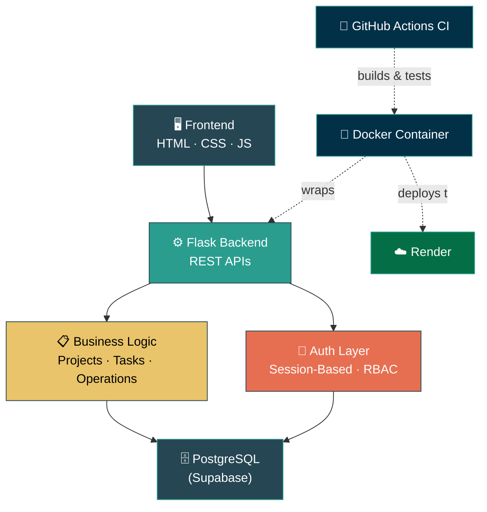
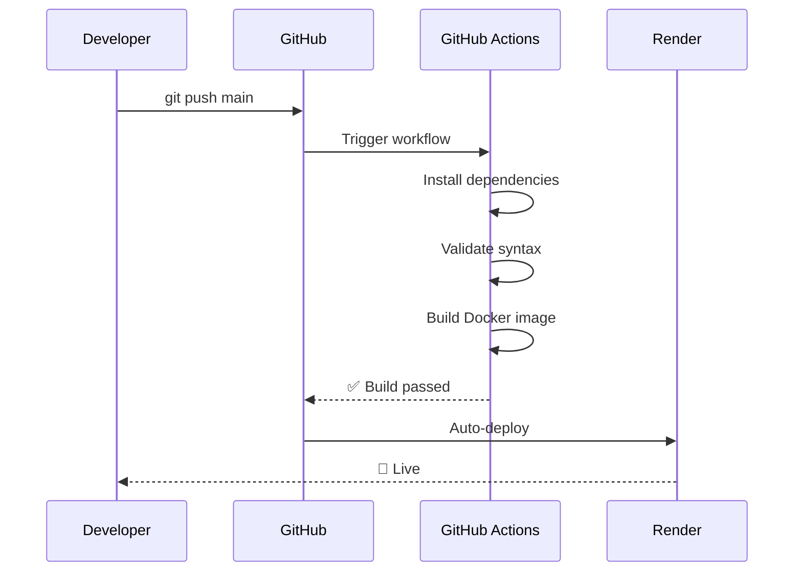

<<<<<<< HEAD
# POMS — Project and Operations Management System

POMS is a Flask web application for one organization to manage users, projects, tasks, and project-related operational records. It uses HTML, CSS, vanilla JavaScript, Jinja2, SQLAlchemy, and Supabase-hosted PostgreSQL.

## Roles

- **Admin:** manages user accounts and roles, and can view workspace records.
- **Manager:** creates and manages projects they own, assigns tasks to Employees, and logs operations for those projects.
- **Employee:** views assigned tasks and updates their own task status.

Authentication, sessions, permissions, input validation, and database access are handled by Python/Flask. JavaScript is only used for UI events.

## Requirements

- Python 3.11 or 3.12
- A Supabase project with PostgreSQL
- Git (recommended)

## Local setup (Windows PowerShell)

```powershell
py -3.12 -m venv .venv
.\.venv\Scripts\Activate.ps1
python -m pip install --upgrade pip
pip install -r requirements.txt
Copy-Item .env.example .env
```

Edit `.env`. Set `SECRET_KEY` to a long random secret and set `DATABASE_URL` to the PostgreSQL connection string from your Supabase project. Use the connection method and SSL options recommended by Supabase for your network and hosting environment. For a URI beginning with `postgresql://`, the app normalizes it to the psycopg 3 SQLAlchemy dialect.

Generate a secret locally with:

```powershell
python -c "import secrets; print(secrets.token_urlsafe(48))"
```

Keep `.env` private. It is excluded by `.gitignore`. Do not put credentials in JavaScript, HTML, screenshots, GitHub, or public logs.

## Database migrations

After setting `.env`:

```powershell
flask --app wsgi.py db init
flask --app wsgi.py db migrate -m "initial schema"
flask --app wsgi.py db upgrade
```

`db init` is needed only once per repository. The generated `migrations/` folder should be committed to Git. Review generated migrations before applying them. Do not run migration initialization on every production startup.

## Create the first Admin

This project deliberately does not ship with a default administrator or public role selection. Create the first Admin using a one-time secure provisioning script run from the server environment, or temporarily use a controlled Flask shell procedure after the database schema has been migrated.

Example controlled Flask shell procedure:

```powershell
flask --app wsgi.py shell
```

Then enter:

```python
from app.extensions import db
from app.models import User
username = input("Admin username: ").strip()
email = input("Admin email: ").strip().lower()
password = input("Admin password (minimum 12 characters): ")
assert len(password) >= 12
assert not User.query.filter((User.username == username) | (User.email == email)).first()
admin = User(username=username, email=email, role="Admin")
admin.set_password(password)
db.session.add(admin)
db.session.commit()
```

Use this only in a trusted local/server shell. Never create the Admin through a public endpoint. Avoid saving the password in shell history. Once the first Admin exists, create subsequent accounts through **User management**.

## Run locally

```powershell
flask --app wsgi.py run --debug
```

Open `http://127.0.0.1:5000`. Local development uses `SESSION_COOKIE_SECURE=false`; HTTPS production should use `true`.

## Tests and lint

Tests use an isolated in-memory SQLite database and do not touch the configured Supabase database:

```powershell
pytest -q
ruff check app tests config.py wsgi.py
```

The tests are a starting suite. Add integration tests against a dedicated non-production PostgreSQL database before relying on the application for real organizational data.

## Docker

Ensure `.env` is configured, then:

```powershell
docker compose up --build
```

Open `http://localhost:8000`. The container uses Gunicorn and connects to the configured Supabase database. Do not expose `.env` or database credentials in the image or repository.

## GitHub Actions

The workflow in `.github/workflows/ci.yml` runs Ruff and pytest on pushes and pull requests. It does not deploy to Render. Review CI results before merging.

## Render deployment

1. Push the repository to GitHub.
2. Create a Render web service from the repository and use the included `render.yaml` Blueprint configuration.
3. Set `DATABASE_URL` in Render to the connection string from Supabase. Prefer the Supabase connection option suited to Render's network and connection requirements.
4. Confirm `SECRET_KEY` is a strong generated value and `SESSION_COOKIE_SECURE=true`.
5. Deploy, inspect logs, then run database migrations using a controlled release/shell process before using the app.
6. Create the first Admin from a trusted server shell or one-time provisioning process.
7. Verify `/health`, login, all role boundaries, project/task/operation workflows, and logs.

The provided Render configuration does not claim to run migrations automatically or to have already deployed the application. Service availability and pricing depend on provider plans.

## Security notes and current limitations

- Passwords are stored as Werkzeug scrypt hashes.
- Flask-Login manages server-side authenticated sessions using signed session cookies.
- Flask-WTF CSRF protection is enabled for forms.
- Flask-Limiter provides a basic login rate limit. Its in-memory storage is suitable only for a single-process development setup; configure a shared production storage backend for multi-worker rate limiting.
- Set secure cookies and use HTTPS in production.
- Do not use the development server in production.
- Public registration is disabled; Admins provision accounts.
- The first Admin must be provisioned securely by an operator.
- Password reset, forced password change, audit log, notifications, analytics, and multi-tenant support are not implemented.
- The landing page's dashboard preview is illustrative. Its dashes are intentionally not live metrics.
- Review authorization and migration behavior before using this application with sensitive organizational data.

## Troubleshooting

- **Database connection error:** re-check the Supabase host, port, username, password, SSL requirements, and connection mode.
- **Missing SECRET_KEY:** set a secure value in `.env`.
- **Tables missing:** apply the Flask-Migrate upgrade command after reviewing migrations.
- **CSRF error:** ensure each state-changing form includes `{{ csrf_token() }}` and that cookies are enabled.
- **Render database connectivity:** use the correct Supabase connection method for the hosting environment and check both provider logs.
=======
<div align="center">

# 🚀 Project & Operations Management System (POMS)

### A full-stack, role-based platform for managing projects, tasks, and teams — built and shipped end-to-end.

[](https://www.python.org/)
[](https://flask.palletsprojects.com/)
[](https://www.postgresql.org/)
[](https://www.docker.com/)
[](https://github.com/features/actions)
[](https://render.com/)

[](#-license)
[]()
[]()
[]()

**[Live Demo](#)** · **[Report Bug](#)** · **[Request Feature](#)**

</div>

---

## 📖 Overview

**POMS** is a centralized web platform that helps organizations plan projects, assign tasks, manage employees, and track operational issues — without juggling five different tools. It's built around three role-specific dashboards (**Admin**, **Manager**, **Employee**), each designed around what that user actually needs to see and do on a given day.

This isn't a CRUD toy app — it's containerized, has a CI pipeline that runs on every push, and is deployed on real infrastructure (Render + Supabase PostgreSQL). It was built to answer one question: *can a fresher ship something that behaves like production software, not just a notebook?*

---

## 🏗️ System Architecture



**Flow:** Request hits Flask → passes through session-based auth & role check → business logic layer resolves the action → PostgreSQL (Supabase) persists/reads data → role-specific dashboard renders. The whole backend is containerized, and every push to `main` triggers a GitHub Actions pipeline that installs dependencies, validates syntax, and builds the Docker image before it ever reaches Render.

---

## ✨ Features

<table>
<tr>
<td width="33%" valign="top">

### 🔑 Authentication
- Secure login & signup
- Session-based auth
- Forgot password flow
- Role-Based Access Control (RBAC)

</td>
<td width="33%" valign="top">

### 🛡️ Admin Module
- Manage managers & employees
- View all users org-wide
- Revoke user access
- System-wide activity monitoring

</td>
<td width="33%" valign="top">

### 📊 Manager Module
- Create & manage projects
- Assign tasks with deadlines
- Track project progress
- View team performance

</td>
</tr>
<tr>
<td width="33%" valign="top">

### 👤 Employee Module
- View assigned projects
- Update task status
- Report operational issues
- Track personal progress

</td>
<td width="33%" valign="top">

### 📈 Dashboards
- Role-specific views
- Live project statistics
- Task tracking widgets
- Operational monitoring

</td>
<td width="33%" valign="top">

### ⚙️ Infra & DevOps
- Dockerized backend
- CI via GitHub Actions
- Deployed on Render
- Supabase PostgreSQL

</td>
</tr>
</table>

---

## 🛠️ Tech Stack

| Layer | Technology |
|---|---|
| **Frontend** | HTML5, CSS3, JavaScript |
| **Backend** | Python, Flask, REST APIs |
| **Database** | PostgreSQL (Supabase) |
| **DevOps** | Docker, Git, GitHub Actions (CI), Render |

---

## 👥 User Roles at a Glance

```
┌─────────────┐      ┌─────────────┐      ┌─────────────┐
│    ADMIN    │      │   MANAGER   │      │  EMPLOYEE   │
├─────────────┤      ├─────────────┤      ├─────────────┤
│ Manage all   │      │ Create      │      │ View        │
│ users        │      │ projects    │      │ assigned    │
│              │      │             │      │ work        │
│ Control      │      │ Assign      │      │ Update      │
│ access       │      │ tasks       │      │ status      │
│              │      │             │      │             │
│ Monitor org  │      │ Track       │      │ Report      │
│ activity     │      │ deadlines   │      │ issues      │
└─────────────┘      └─────────────┘      └─────────────┘
```

---

## 🗄️ Database Entities

`Users` · `Projects` · `Tasks` · `Operations` · `Roles`

Normalized relational schema (5+ entities) enforcing referential integrity across role assignments, project ownership, and task status transitions.

---

## 📂 Project Structure

```text
Project-Operations-Manager/
│
├── backend/
│   ├── app.py
│
├── frontend/
│   ├── static/
│   │   ├── css/
│   │   ├── js/
│   │   └── images/
│   └── templates/
│
├── .github/
│   └── workflows/       # CI pipeline definitions
│
├── Dockerfile
├── requirements.txt
├── .env
└── README.md
```

---

## ⚙️ Getting Started

### 1. Clone the repository
```bash
git clone [https://github.com/Tanmay1113/P-Op-s.git]
cd Project-Operations-Manager
```

### 2. Install dependencies
```bash
pip install -r requirements.txt
```

### 3. Configure environment variables
Create a `.env` file in the root directory:
```env
DB_HOST=your_supabase_host
DB_PORT=5432
DB_NAME=postgres
DB_USER=postgres
DB_PASSWORD=your_password
SECRET_KEY=your_secret_key
```

### 4. Run the application
```bash
python backend/app.py
```

Visit **`http://localhost:5000`** 🎉

---

## 🐳 Running with Docker

```bash
# Build the image
docker build -t project-ops-manager .

# Run the container
docker run -p 5000:5000 project-ops-manager
```

---

## 🔄 CI/CD Pipeline

The project runs a fully connected **GitHub Actions** pipeline, actively maintained with daily updates. Every push to `main` automatically triggers a workflow that:

- ✅ Installs all dependencies
- ✅ Validates Python syntax
- ✅ Builds the Docker image
- ✅ Deploys the latest build to Render



---

## ☁️ Deployment

| Component | Service |
|---|---|
| **Application Hosting** | Render |
| **Database** | Supabase PostgreSQL |
| **Containerization** | Docker |
| **Version Control** | Git & GitHub |

---

## 📌 Project Status

<table>
<tr>
<td valign="top" width="50%">

### ✅ Completed
- Landing page
- User authentication
- Role-Based Access Control
- Admin dashboard
- Manager dashboard
- Employee dashboard
- PostgreSQL integration
- Docker integration
- GitHub Actions CI
- Render deployment

</td>
<td valign="top" width="50%">

### 🚧 In Progress
- Project management module
- Task management module
- Operations management module
- Notifications system
- Reports & analytics

</td>
</tr>
</table>

---

## 🔮 Future Enhancements

- 📧 Email notifications
- 📎 File uploads
- 📜 Activity logs
- 📊 Analytics dashboard
- 🤖 AI-based task recommendations
- 🔔 Real-time notifications
- 📅 Calendar integration
- 📱 Mobile-responsive UI

---

## 👨‍💻 Author

**Tanmay Bhole**
B.Sc. Information Technology Student
Passionate about Backend Development, Cloud Computing, DevOps, and Full-Stack Systems.

[](https://linkedin.com/in/tanmaybhole)
[](https://github.com/Tanmay1113)
[](mailto:tanmaybhole001@gmail.com)
>>>>>>> c95fd2be38c55bee40da6724b9446c0b27eeda77
